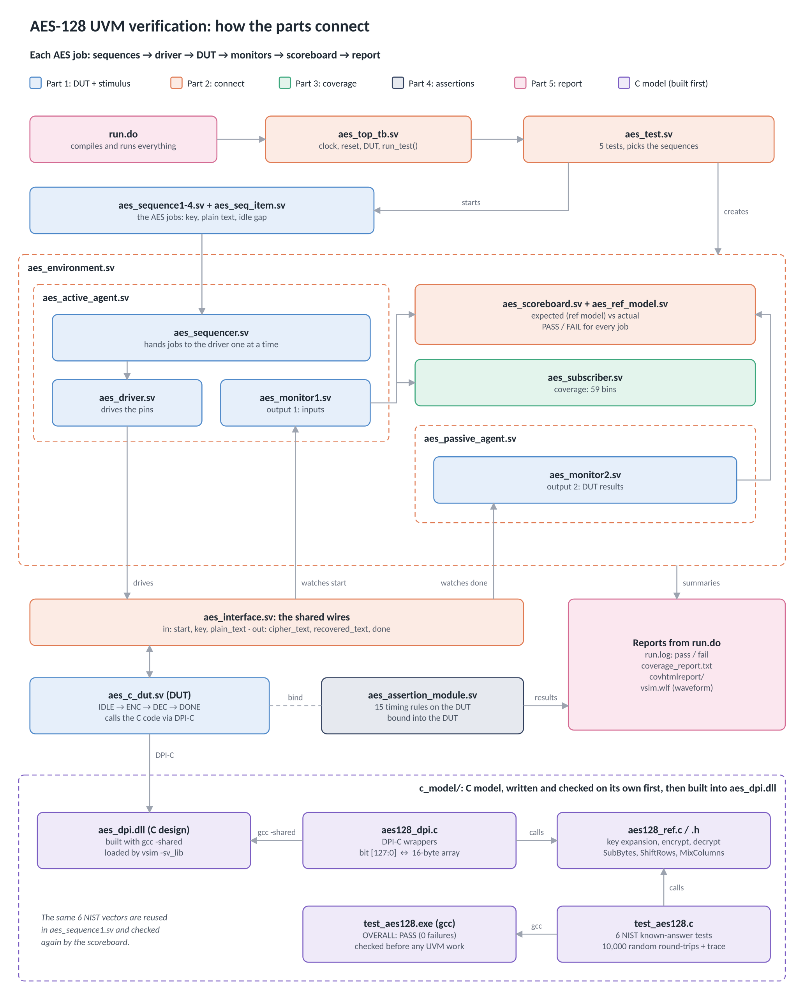

# Coverage-Driven UVM Verification of an AES-128 Core Using DPI-C

A UVM testbench for AES-128 (FIPS-197) that checks encryption and decryption against an independent reference model and NIST known-answer vectors, with constrained-random stimulus, functional coverage and SystemVerilog assertions. The C model is linked into the simulator through DPI-C.

Masters project (COMPE 798), San Diego State University.

## Repository layout

```
c_model/        AES-128 C model + standalone test
  aes128_ref.c/.h   key expansion, encrypt, decrypt, round-by-round trace
  aes128_dpi.c      DPI-C wrappers (bit [127:0] <-> byte array)
  test_aes128.c     NIST known-answer tests + 10,000 random round-trips + trace
uvm_tb/         UVM testbench (QuestaSim 10.7c, UVM-1.1d)
  aes_top_tb.sv     top module, includes everything
  aes_c_dut.sv      DUT: C design behind a clocked start/done interface
  aes_ref_model.sv  independent SystemVerilog AES-128 used by the scoreboard
  aes_*.sv          seq item, sequences 1-4, driver, monitors, agents,
                    scoreboard, coverage subscriber, environment, tests
  aes_assertion_module.sv   15 SVA properties + 1 cover, bound into the DUT
  run.do            compile, simulate, wave setup, coverage report
docs/
  architecture.vsdx         architecture diagram (Microsoft Visio)
  architecture.png          same diagram as an image
results/
  coverage_report.txt       functional coverage + assertion summary
  covhtmlreport/            Questa HTML coverage report (open index.html)
  screenshots/              C test output, waveform with assertion markers
```

## Architecture



Editable Microsoft Visio version: [`docs/architecture.vsdx`](docs/architecture.vsdx)

The project is split into a C model, built and checked first, followed by five UVM parts:

| | Part | Files |
|---|---|---|
| 0 | **C model** | `aes128_ref.c/.h`, `aes128_dpi.c`, `test_aes128.c`, built into `aes_dpi.dll` |
| 1 | **DUT + stimulus** | `aes_c_dut.sv`, `aes_seq_item.sv`, `aes_sequence1-4.sv`, `aes_sequencer.sv`, `aes_driver.sv`, monitors |
| 2 | **Connect** | `aes_interface.sv`, `aes_top_tb.sv`, agents, `aes_environment.sv`, `aes_test.sv`, `aes_scoreboard.sv` + `aes_ref_model.sv` |
| 3 | **Coverage** | `aes_subscriber.sv` |
| 4 | **Assertions** | `aes_assertion_module.sv` (bound into the DUT) |
| 5 | **Report** | `run.do` → `run.log`, `coverage_report.txt`, `covhtmlreport/`, `vsim.wlf` |

Each AES job flows through sequences → driver → DUT → monitors → scoreboard → report. The DUT calls the C code through DPI-C. The scoreboard checks every result against an independent SystemVerilog reference model and, for the known-answer inputs, against the NIST cipher text as well.

**Tests** (`+UVM_TESTNAME=`)

| Test | What it runs |
|---|---|
| `testcase` | full regression: KAT + random + constrained-random + targeted |
| `testcase1` | NIST known-answer vectors only |
| `testcase2` | pure random (shows the coverage holes) |
| `testcase3` | random + constrained-random |
| `testcase4` | random + targeted closure sequence |

**Functional coverage**: key pattern × plain-text pattern (all-zero, all-one, walking-one, walking-zero, repeated byte, random; 36-bin cross), idle gap between operations, key/plain-text MSB ranges.

**Assertions**: reset behaviour, start/done single-cycle pulses, start only when idle, inputs stable while busy, fixed start-to-done latency, no X/Z on outputs, decrypt(encrypt(pt)) == pt, FSM sequencing IDLE→ENC→DEC→DONE, counter range, busy flag.

## How to run

**1. C model (MSYS2 UCRT64 or any gcc)**
```bash
cd c_model
gcc -O2 -Wall -o test_aes128 aes128_ref.c test_aes128.c
./test_aes128
```

**2. Build the DPI library (MSYS2)**
```bash
cd uvm_tb
gcc -shared -std=gnu99 -static-libgcc -I/c/questasim64_10.7c/include -I../c_model \
    -o aes_dpi.dll ../c_model/aes128_ref.c ../c_model/aes128_dpi.c
```

**3. Simulate (QuestaSim, inside `uvm_tb/`)**
```
do run.do
```
Change `+UVM_TESTNAME` in `run.do` to pick a test. The coverage report is written to `coverage_report.txt`.

## Results so far

- C model: all 6 FIPS-197 / SP 800-38A known-answer vectors pass (encrypt and decrypt), 0 failures in 10,000 random round-trips.
- UVM full regression (`testcase`): 445 transactions, functional coverage 100% (59/59 bins), all 15 assertions pass with 0 failures, cover directive hit.
- DUT code coverage: 96.5% overall (statements 29/30, branches 12/13, toggles 99.8%, FSM states 4/4, FSM transitions 4/6).

## Status

The DUT is currently the C design wrapped in a clocked SystemVerilog shell (`aes_c_dut.sv`). Its ports match the `AES_TOP_iterative` RTL, so the same environment can drive the Verilog RTL next.
